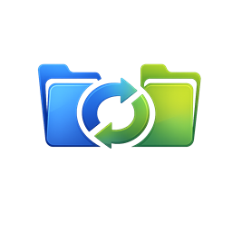
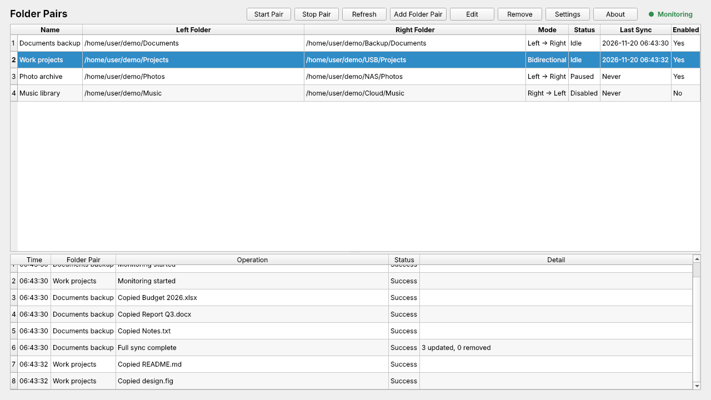
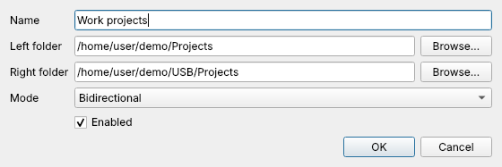
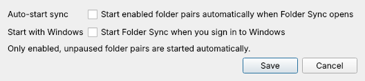
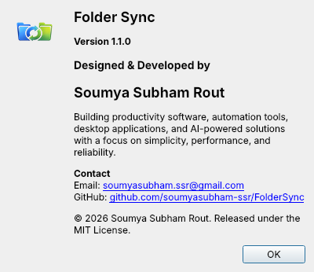

<p align="center">
  
</p>

<h1 align="center">Folder Sync</h1>

<p align="center">
  Real-time, event-driven folder synchronization for Windows — one-way or bidirectional, from the system tray.
</p>

<p align="center">
  <a href="https://github.com/soumyasubham-ssr/FolderSync/releases/latest"></a>
  <a href="https://github.com/soumyasubham-ssr/FolderSync/actions/workflows/ci.yml"></a>
  
  
  <a href="LICENSE"></a>
</p>

<p align="center">
  
</p>

## Features

- **Live sync.** Watches both folders and mirrors creates, edits, renames and deletes within a second.
- **Three modes per pair:** Bidirectional, Left → Right, and Right → Left.
- **Initial mirror.** Starting a pair first brings the two folders in line. Files that are already identical are skipped.
- **Handles busy files.** A locked file (open in Office, for example) is retried with backoff. If it is still locked, it syncs on its next change.
- **Renames are cheap.** A rename on one side becomes a rename on the other, not a delete plus a full re-copy.
- **No sync loops.** Echo events from Folder Sync's own writes are ignored, and identical files are never copied again.
- **Tray app.** Closing the window keeps it running in the system tray. Optionally, it starts with Windows and resumes your pairs.
- **Activity log.** An in-app log panel, plus a rotating log file in `%LOCALAPPDATA%\FolderSync\folder_sync.log`.
- **Lightweight.** Uses an SQLite store and a small thread pool, and needs no administrator rights.

## Download

Get the latest `FolderSync-vX.Y.Z-windows-x64.exe` from the
[Releases page](https://github.com/soumyasubham-ssr/FolderSync/releases/latest) and run it. Nothing needs installing.

> Windows SmartScreen may warn about an unsigned executable. Choose **More info → Run anyway**, or build it yourself from source.

## Quick start

1. Click **Add Folder Pair**, give it a name, pick the **Left** and **Right** folders, and choose a mode.
2. Select the pair and click **Start Pair**. For bidirectional pairs, choose which side is the source for the first mirror.
3. That's it. Changes now flow automatically, and the status column and log panel show what happened.

See the [User Guide](docs/USER_GUIDE.md) for every option.

| Add / edit a pair | Settings | About |
|---|---|---|
|  |  |  |

## Run from source

```bash
git clone https://github.com/soumyasubham-ssr/FolderSync.git
cd FolderSync
python -m pip install -r requirements.txt
python main.py
```

On Windows you can also double-click `launch.bat`.

## Build the executable

```bash
python -m pip install -r requirements.txt -r requirements-dev.txt
build.bat
```

This produces `dist\FolderSync.exe`. Pushing a `v*` tag to GitHub does the same in CI and publishes a release (see [`.github/workflows/release.yml`](.github/workflows/release.yml)).

## Tests

```bash
python -m pytest
```

## Documentation

- [User Guide](docs/USER_GUIDE.md): modes, starting and stopping, settings, troubleshooting
- [Architecture](docs/ARCHITECTURE.md): how the sync engine works
- [Changelog](CHANGELOG.md)
- [Contributing](CONTRIBUTING.md)

## License

[MIT](LICENSE) © 2026 Soumya Subham Rout
