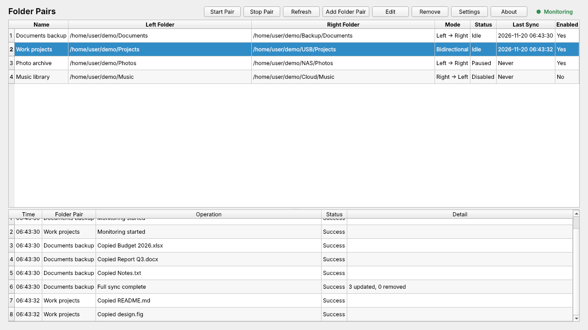

## Folder Sync 1.1.0

This is a cleanup and reliability release. Upgrading is safe: your existing pairs and settings in `%LOCALAPPDATA%\FolderSync` are kept.

### Highlights
- **Faster:** renames are mirrored as renames, and *Start Pair* skips files that are already identical.
- **Safer:** you can't create a pair with the same or nested folders, and folder deletes are handled correctly on Windows.
- **More reliable:** edits made right after a sync are no longer missed, editing a running pair applies immediately, and *Exit* shuts down cleanly.
- **More visible:** a persistent log file, a *Stopped* status, and click-to-restore from the tray.

See the full list in [CHANGELOG.md](https://github.com/soumyasubham-ssr/FolderSync/blob/v1.1.0/CHANGELOG.md).

### Download
| File | Description |
|---|---|
| `FolderSync-v1.1.0-windows-x64.exe` | Portable executable. Just run it. |
| `FolderSync-v1.1.0-windows-x64.zip` | Executable + README + LICENSE + CHANGELOG |
| `SHA256SUMS.txt` | Checksums |

Requires Windows 10 or 11 (64-bit). The executable is not code-signed. If SmartScreen warns you, choose **More info → Run anyway**.
